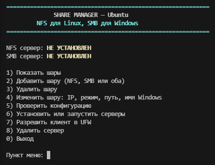

# Share Manager 1.0.0

Первый выпуск. Меню для Ubuntu, которое открывает общие папки по NFS для Linux и по SMB для Windows.



## Возможности

- Одна программа на оба протокола. Пакеты `nfs-kernel-server` и `samba` ставятся из меню, после подтверждения.
- Шару можно добавить только для Linux, только для Windows или сразу для обоих.
- В карточке шары видно каждого клиента. IP добавляется, удаляется и заменяется отдельно, режим ro/rw и путь меняются без потери остальных клиентов.
- У SMB задаётся имя, которое попадает в адрес `\\IP-сервера\имя`. Без списка IP шара открыта всей сети.
- Запись NFS идёт от `nobody`: скрипт предлагает владельца `nobody` и режим `755`. Для Windows Samba нужен режим `775` и группа `nogroup`, это предлагается отдельно.
- Проверка конфигурации заново применяет экспорт NFS и читает конфиг Samba.
- Для клиента можно записать правила UFW: порты `2049` и `111` для NFS, порт `445` для SMB.
- Сервер удаляется из того же меню. Файл экспорта и шары SMB можно оставить или очистить.
- Если `exportfs` или `testparm` не принимает запись, изменённый файл возвращается к прежнему содержимому.

## Запуск

```bash
sudo bash share-manager.sh
```

Проверено на Ubuntu 26.04.

## Автор

Avmbur <avmbur@gmail.com>
